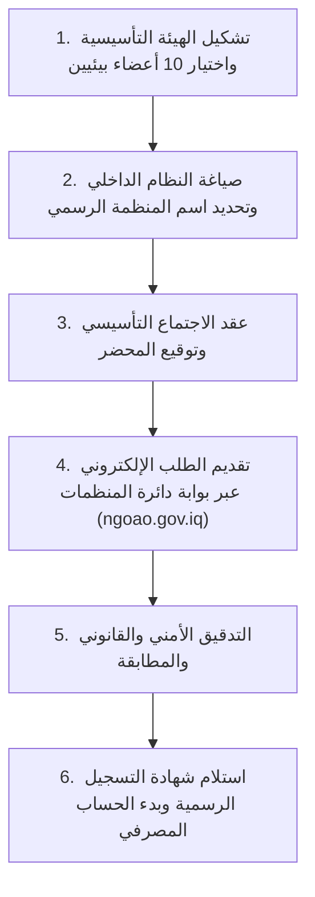

# خارطة طريق التسجيل القانوني والمؤسسي لمبادرة نَفَس (NAFAS)
## في جمهورية العراق الاتحادية وإقليم كوردستان
**إعداد:** NYX OMNI ULTIMATE V3 (SUPERMAN Edition)  
**تاريخ الإعداد:** 24 تشرين الثاني (نوفمبر) 2026  
**حالة المنصة الحالية:** مبادرة بيئية تكنولوجية مجتمعية في مرحلة الجاهزية الفنية والامتثال الأولي (غير مسجلة رسمياً كمنظمة حتى الآن).

---

## 1. إخلاء مسؤولية قانوني إلزامي
> [!IMPORTANT]
> **هذه الوثيقة هي دليل إرشادي وبحثي استشاري لتوجيه المؤسس، ولا تُعد استشارة قانونية نهائية ولا ترقى لصفة الترخيص الحكومي. لا يجوز الادعاء بأن منصة نَفَس هي منظمة مرخصة رسمياً أو حاصلة على اعتراف حكومي نهائي إلا بعد إتمام إجراءات التسجيل الرسمية واستلام شهادة التسجيل الصادرة من الجهات المعنية أدناه، وبإشراف محامٍ عراقي معتمد.**

---

## 2. المسارات القانونية المتاحة في العراق

لتحويل مبادرة "نَفَس" إلى كيان قانوني معترف به رسمياً، يوجد مساران رئيسيان بحسب النطاق الجغرافي والإداري للمنظمة:

### المسار الأول: التسجيل في بغداد — دائرة المنظمات غير الحكومية الاتحادية
- **المرجع القانوني:** قانون المنظمات غير الحكومية رقم (12) لسنة 2010.
- **الجهة المسؤولة:** دائرة المنظمات غير الحكومية — الأمانة العامة لمجلس الوزراء (بغداد).
- **البوابة الإلكترونية الرسمية:** [دائرة المنظمات غير الحكومية العراقية](https://www.ngoao.gov.iq)
- **نطاق العمل:** يمنح حق العمل والنشاط في كافة محافظات العراق الـ 18.

### المسار الثاني: التسجيل في إقليم كوردستان — فەرمانگەی ڕێکخراوە ناحکومییەکان (DNGO)
- **المرجع القانوني:** قانون المنظمات غير الحكومية في إقليم كوردستان رقم (1) لسنة 2011.
- **الجهة المسؤولة:** دائرة المنظمات غير الحكومية في حكومة إقليم كوردستان (أربيل).
- **البوابة الإلكترونية الرسمية:** [فەرمانگەی ڕێکخراوە ناحکومییەکان](https://dngo.gov.krd)
- **نطاق العمل:** يمنح حق العمل في محافظات الإقليم (أربيل، السليمانية، دهوك، حلبجة)، مع إمكانية فتح فروع في باقي المحافظات لاحقاً بالتنسيق الاتحادي.

---

## 3. قائمة المتطلبات والوثائق اللازمة (Founder Checklist)

| الرقم | الوثيقة المطلوبة | التفاصيل والشروط القانونية | الحالة الراهنة |
|---|---|---|---|
| **1** | **الهيئة التأسيسية (الأعضاء المؤسسون)** | لا يقل عن **10 أشخاص** عراقيين كاملي الأهلية القانونية (للاتحادي)، أو **5 إلى 7 أشخاص** (لإقليم كوردستان)، مع نسخ ملونة من البطاقة الوطنية الموحدة أو هوية الأحوال وشهادة الجنسية | قيد الإعداد والاختيار من قبل المؤسس |
| **2** | **النظام الداخلي (Bylaws)** | صياغة مسودة النظام الداخلي متضمنة: اسم المنظمة (نَفَس للبيئة)، أهدافها البيئية المجتمعية غير الربحية، الهيكل الإداري، الموارد المالية، وآليات حل المنظمة | مسودة جاهزة متطابقة مع أهداف المنصة |
| **3** | **محضر الاجتماع التأسيسي** | توثيق اجتماع الأعضاء المؤسسين، انتخاب الهيئة الإدارية ورئيس المنظمة (المؤسس)، والتوقيع على النظام الداخلي | بانتظار عقد الاجتماع الفعلي |
| **4** | **شهادات عدم المحكومية** | كتب رسمية من الأدلة الجنائية تؤكد خلو السجل الجنائي لكافة الأعضاء المؤسسين من الجنايات والجنح المخلة بالشرف | تُطلب بعد التقديم الأولي |
| **5** | **مقر المنظمة وعقد الإيجار** | توفير مقر رسمي للمنظمة (سند ملكية أو عقد إيجار مصدق من كاتب العدل) | يحدده المؤسس في مرحلة لاحقة |
| **6** | **الحساب المصرفي الرسمي** | فتح حساب مصرفي باسم المنظمة في مصرف عراقي معتمد (يتم ذلك بعد صدور شهادة التسجيل الأولية بكتاب رسمي من دائرة المنظمات) | مؤجل لما بعد التسجيل |

---

## 4. الخطوات التنفيذية للتسجيل (Step-by-Step Procedure)

1. **الخطوة 1 (الإعداد الداخلي):** توجيه الدعوة للناشطين البيئيين والأكاديميين لتشكيل الهيئة التأسيسية برئاسة المؤسس.
2. **الخطوة 2 (التسجيل الإلكتروني):** الدخول إلى النظام الإلكتروني لدائرة المنظمات وإنشاء حساب لتقديم المعاملة.
3. **الخطوة 3 (مراجعة الدائرة):** استلام كتاب إحالة الأدلة الجنائية وإجراء الفحص الأمني للأعضاء.
4. **الخطوة 4 (الموافقة والترخيص):** صدور قرار الموافقة، منح شهادة التسجيل، والنشر في جريدة الوقائع العراقية إن لزم.

---

## 5. التكاليف التقديرية والاشتراطات المالية
- **رسوم التسجيل الحكومية:** بموجب قانون المنظمات رقم 12 لسنة 2010 وقانون رقم 1 لسنة 2011، فإن تقديم طلبات تسجيل المنظمات غير الحكومية معفى من الرسوم الكبيرة تشجيعاً للمجتمع المدني (توجد رسوم طوابع رمزية وتصديق كاتب العدل لا تتجاوز حدود 50,000 إلى 150,000 دينار عراقي).
- **عقد الإيجار والمقر:** يعتمد على المدينة وموقع المقر.
- **أتعاب المحاماة والتعقيب:** استشارة محامٍ لتصديق الأوراق تتراوح حسب الاتفاق.
- **القاعدة الذهبية:** المنصة البرمجية تدار حالياً بـ **0$ كلفة استضافة**، ويجب عدم دفع أي مبالغ أو الشروع بالتسجيل الرسمي إلا بقرار خطي ومباشر من المؤسس.

---

## 6. المسائل التي تتطلب استشارة محامٍ عراقي معتمد
قبل التقديم النهائي إلى دائرة المنظمات غير الحكومية، يوصى بعرض الملف على محامٍ مقيد في نقابة المحامين العراقيين لمراجعة:
1. صياغة المواد المتعلقة بتمويل المنظمة والتبرعات غير المشروطة وفق قانون مكافحة غسل الأموال رقم (39) لسنة 2015.
2. حماية الملكية الفكرية لشعار واسم "نَفَس" في دائرة التسجيل العقاري والملكية الصناعية بوزارة الصناعة والمعادن.
3. التوافق التام مع ضوابط التعامل مع الجهات الدولية والمنظمات التابعة للأمم المتحدة (UNDP / UNEP) المعنية بالبيئة.
