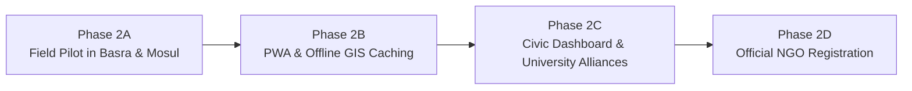

# NAFAS Iraq — Phase 2 Strategic Execution Plan
## Community Expansion, Field Pilot & Civic Adoption
**Date:** 24 November 2026  
**Auditor / Architect:** NYX OMNI ULTIMATE V3 (SUPERMAN Edition)  
**Budgetary Constraint:** **$0.00 (Zero-Cost Architecture Preserved)**  
**Target Milestone:** Transition from Security Hardening to Field Deployment

---

## 1. Executive Vision

With the completion of **Operation NAFAS Fortress**, the core software foundation is hardened against OWASP ASVS 5.0 Level 2 vulnerabilities, legal and privacy policies are drafted, and administrative AAL2 controls are verified.

**Phase 2** pivots NAFAS from an engineering fortress into an active, community-driven civic platform that connects citizens, university students, and municipal teams across Iraq.

---

## 2. Phase 2 Key Milestones & Roadmap

### Phase 2A: Reforestation Field Pilots (Month 1 - 2)
- **Pilot Regions:**
  - **Basra:** Focus on date palm grove restoration and canal salinity monitoring.
  - **Mosul / Nineveh:** Focus on post-conflict urban greening and park rehabilitation.
- **Pilot Goals:**
  - Onboard 50 verified volunteer leaders.
  - Coordinate 5 community planting days using the NAFAS Campaign Manager.
  - Test field report submission under real network conditions (3G/4G).

### Phase 2B: Progressive Web App (PWA) & Offline GIS (Month 2 - 3)
- **Service Worker & Offline Tile Caching:** Enable citizens in remote marshes (Ahwar) and rural areas with intermittent connectivity to draft reports and take photos offline, with automatic sync upon reconnection.
- **Web Push Notifications:** Real-time reminders for campaign check-ins without third-party proprietary dependencies.
- **Zero-Cost Constraint:** Rely exclusively on standard browser Service Worker APIs and local IndexedDB.

### Phase 2C: Academic & Municipal Integration (Month 3 - 4)
- **University Partnerships:** Engage environmental science departments in Baghdad, Basra, and Mosul universities to validate plant database entries and monitor satellite vegetation indices.
- **Municipal Transparency Dashboard:** A dedicated read-only municipal view allowing local governorate cleaning departments to review approved community complaints and update remediation status.

### Phase 2D: Formal NGO Registration (Founder Track)
- Execute the roadmap defined in `LEGAL_REGISTRATION_ROADMAP.md` under the founder's explicit direction.
- File formal incorporation papers with the Iraqi Department of Non-Governmental Organizations (NGOAO) or KRG DNGO.

---

## 3. Engineering Guardrails for Phase 2

1. **Zero Financial Drift:** All new features must run within the free tiers of GitHub Pages, Supabase, and open-source packages.
2. **AAL2 Privilege Preservation:** No new administrative feature may bypass multi-factor authentication.
3. **Citizen Privacy Non-Negotiable:** No feature shall compromise the whistleblower coordinate masking or volunteer contact confidentiality protocols established in Phase 1.
4. **Clean Commits & Automated CI:** Every change must pass the enhanced `security-ci.yml` pipeline with 0 secret leaks and 100% test pass rate.
